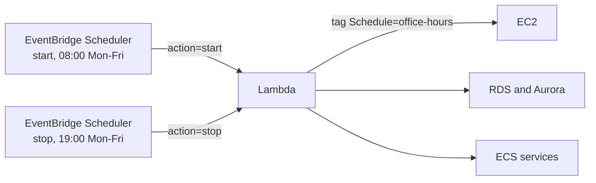

# terraform-aws-resource-scheduler

[](https://github.com/Yatharth121/terraform-aws-resource-scheduler/actions/workflows/ci.yml)

Stop non-production AWS resources outside working hours and start them again in the morning. Resources opt in with one tag.

Dev and staging environments usually sit idle for about two-thirds of the week. Running them only on weekday business hours (11 hours × 5 days) cuts their compute bill by roughly 65%.

## What it schedules

| Resource | Stop | Start |
| --- | --- | --- |
| EC2 instances | `StopInstances` | `StartInstances` |
| RDS instances | `StopDBInstance` | `StartDBInstance` |
| Aurora clusters | `StopDBCluster` | `StartDBCluster` |
| ECS services | Saves desired count to a tag, sets it to 0 | Restores the saved count |

It deliberately skips:
- EC2 instances in an Auto Scaling group, since the ASG would replace them. Scale the ASG instead.
- RDS read replicas and their sources, which AWS can't stop.
- Aurora member instances, which are handled through their cluster.

## How it works



- Schedules run in a real time zone (default `America/Toronto`), so daylight saving changes don't shift them.
- Every write permission is limited by an IAM condition on the schedule tag. The function can't stop anything that isn't tagged, even if the code has a bug.
- `dry_run = true` logs what would change without touching anything. Use it on first rollout.
- `schedules_enabled = false` pauses scheduling without destroying anything, for release weeks or incidents.

## Usage

```hcl
module "scheduler" {
  source  = "Yatharth121/resource-scheduler/aws"
  version = "~> 0.1"

  name     = "dev-office-hours"
  timezone = "America/Toronto"
}
```

Then tag what should follow the schedule:

```hcl
tags = {
  Schedule = "office-hours"
}
```

See [`examples/basic`](examples/basic) for a full example.

### Rolling out across many accounts

Deploy the module once per account and region, for example with one Terraform workspace per account, or from a pipeline that assumes a role in each account. Each copy only touches resources in its own account.

### Encrypted EBS volumes

Instances with volumes encrypted by a customer-managed KMS key won't start unless the function can create grants on that key. Pass those keys in `kms_key_arns`.

## Testing

| Layer | Tool | Needs AWS? |
| --- | --- | --- |
| Function logic | `pytest` with fake clients | No |
| Module wiring | `terraform test` with mocked providers | No |
| Lint | `tflint` with the AWS ruleset | No |
| Security | `checkov`, with every skip justified in [`.checkov.yaml`](.checkov.yaml) | No |

All four run on every pull request.

<!-- BEGIN_TF_DOCS -->
## Inputs

| Name | Description | Type | Default |
| --- | --- | --- | --- |
| `name` | Name prefix for the Lambda function, IAM roles and schedules. | `string` | `"resource-scheduler"` |
| `schedule_tag_key` | Tag key that opts a resource into scheduling. | `string` | `"Schedule"` |
| `schedule_tag_value` | Tag value that opts a resource into scheduling. | `string` | `"office-hours"` |
| `start_schedule` | EventBridge Scheduler expression for starting resources. | `string` | `"cron(0 8 ? * MON-FRI *)"` |
| `stop_schedule` | EventBridge Scheduler expression for stopping resources. | `string` | `"cron(0 19 ? * MON-FRI *)"` |
| `timezone` | IANA time zone the schedules run in. | `string` | `"America/Toronto"` |
| `enable_ec2` | Schedule tagged EC2 instances. | `bool` | `true` |
| `enable_rds` | Schedule tagged RDS instances and Aurora clusters. | `bool` | `true` |
| `enable_ecs` | Schedule tagged ECS services. | `bool` | `true` |
| `dry_run` | Log what would change without changing anything. | `bool` | `false` |
| `schedules_enabled` | Set to false to pause both schedules. | `bool` | `true` |
| `kms_key_arns` | KMS keys used by encrypted EBS volumes on scheduled instances. | `list(string)` | `[]` |
| `log_retention_days` | How long to keep the function's logs. | `number` | `30` |
| `tags` | Tags applied to every resource this module creates. | `map(string)` | `{}` |

## Outputs

| Name | Description |
| --- | --- |
| `lambda_function_name` | Name of the scheduler Lambda function. |
| `lambda_function_arn` | ARN of the scheduler Lambda function. |
| `lambda_role_arn` | ARN of the IAM role the function runs as. |
| `schedule_arns` | ARNs of the start and stop schedules. |
| `log_group_name` | CloudWatch log group for the function. |
<!-- END_TF_DOCS -->

## License

MIT
